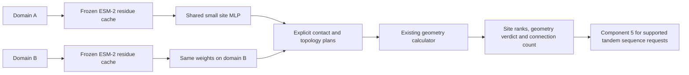

# Attachment sites and connection plans

The human's 18 October 2026 instruction resumes implementation of architecture
component 4 before data exists. It follows [architecture PR #7](https://github.com/richennacht/LinkerForge/pull/7),
now merged at `410aa794bffbc66cf26dd927c182eb7733d01b6b`.
The generator is published separately in [PR #9](https://github.com/richennacht/LinkerForge/pull/9).
This is trainable/tested software, not trained biological predictions.

## What the model answers

The model ranks **operation-specific attachment tolerance**. Given a domain,
it produces a score for each eligible residue operation. The same domain tower
is applied independently to A and B; neither partner identity nor rigid,
flexible or cleavage choices enter the sequence encoder or site head.



The reference configuration is frozen ESM-2 3B, layer 36, 2,560 features per
residue, followed by `Linear(2560,1280) → ReLU → Linear(1280,3)`.
The three outputs are separate endpoints, not interchangeable labels:

| Operation | Eligible anchor positions, 1-based | Meaning |
| --- | --- | --- |
| `internal_insertion` | 1 through L−1 | Insert **after** this residue, before the next |
| `n_terminal_extension` | 1 | Extend **before** the first residue |
| `c_terminal_extension` | L | Extend **after** the last residue |

The original ProDomino implementation uses a single `2560 → 1280 → 1` MLP.
This fresh implementation shares its basic architecture, with separate output
channels to prevent insertion labels being silently reused for terminal
extension. This is **not a reproduction of ProDomino's weights or results**.
Terminal heads stay `untrained_no_score` unless actual fitting batches have
provided both positive and negative supervision for that task. Their values
cannot be used to claim support for an untrained operation.

This decomposition is a hypothesis. A single-domain tower cannot represent
arbitrary donor/recipient interactions. Training labels therefore require an
explicit donor-aggregation policy and defined assay endpoint. Natural insertion
events are positive observations; missing insertion annotations are unknown,
not negatives. Natural linker-flanking residues are **not automatically validated
insertion-tolerance labels** and are refused by this loader. A single-donor
assay, surface expression, allostery and general fusion function are distinct
targets. No new biological fitness threshold is supplied here.

## Number of linkers and geometry

Connection count follows an explicit construction plan:

- Tandem `A—linker—B`: one peptide connection, from C(A) to N(B).
- Insertion into A after i: two connections, from A(i) to N(B), then C(B) to
  A(i+1). These share one donor placement; they are not independent tandems.

`AttachmentPlan` validates topology, exact residue positions and supplied
linker lengths. It does not pretend to learn an optimal number of tethers in
the absence of count labels. Three-plus peptide connections, multiple insertions,
crosslinks and arbitrary chain rearrangements require a separate topology
protocol. Zero residues can represent a direct peptide connection; positive
length sequence generation remains a separate request to component 5.

`evaluate_geometry` delegates to the already merged
`linkerforge.geometry.evaluate_tether_set`. Sequence positions must map explicitly
and one-to-one to PDB residue numbers, with residue identities checked. PDB
numbering is never assumed to equal sequence numbering. Missing anchors or
unsupported insertion-code mappings fail explicitly. The adapter bounds calls
to at most eight restarts by 100 iterations (default two by 20); it changes no
shared geometric constants or thresholds.

`rank_plans` verifies plan/geometry hashes, rejects reported infeasibility or
observed clash failures, and retains `undetermined` as unknown. With all required
heads assessed, a documented heuristic averages operation logits and prioritizes
witnessed geometry among equally assessed plans. An insertion's recipient cut
is scored once; donor N/C extension are separate required operations. Missing
head supervision remains unassessed, never zero confidence. Sequence scores,
geometric witnesses and search failures do not establish folding or function.
The generator currently supports tandem only; no internal anchors are silently
passed to it as a tandem fusion.

## Executable commands

Use the dependency versions in `requirements/generator-cpu.txt` and a dedicated
environment; `pyproject.toml` now includes the `linkerforge-attachment` entry
point. The source script resolves this checkout's package explicitly.

```powershell
python scripts/attachment_site_model.py --help
python -m unittest discover -s tests -p test_attachment_sites.py -v
python scripts/attachment_site_model.py smoke --output tmp/attachment-smoke
python scripts/attachment_site_model.py preflight --manifest artifacts/reviewed-sites/manifest.json
python scripts/attachment_site_model.py train --manifest artifacts/reviewed-sites/manifest.json --config configs/attachment-site-mlp.json --execution-receipt artifacts/reviewed-site-execution.json --device cuda --output artifacts/site-round-01
python scripts/attachment_site_model.py benchmark-development --manifest artifacts/reviewed-sites/manifest.json --checkpoint mlp=artifacts/site-round-01/step-001000 --coverage-fraction FROZEN_FRACTION --output artifacts/site-development.json
```

For module/unittest invocation without an editable install, set `PYTHONPATH` to
this checkout's `src`. These are future scientific paths, not existing data.
The smoke instead invents 12 record/task pairs across four short strings, uses
random 8-dimensional vectors, and performs exactly three CPU updates. Every
artifact is marked synthetic. No accuracy or biological result follows from it.

The `score` command accepts a checkpoint, `--sequence-json` containing exactly
`{"sequence":"..."}`, a frozen `--embedding` cache and its required
`--embedding-sha256`. It returns residue positions/logits and task eligibility,
with an explicit uncalibrated interpretation and synthetic provenance flag.
`rank-plans` accepts JSON with `plans`, `domain_scores` and `geometry_reports`;
the Python `evaluate_geometry` helper produces the bound geometry interface.

## Data and frozen-feature handoff: private v0 proposal

No shared schema was altered. This component proposes
`format="attachment-site-dataset.v0"` with:

- `dataset_id`, `kind="scientific_dataset"`, and actual dataset review metadata
  (`review.approved`, `reviewer`, `reference`).
- `encoder`: `model_id`, immutable 40-character `revision`, `weights_sha256`,
  selected `layer` and `embedding_dim`. For the local extraction helper,
  `weights_sha256` is the canonical hash of the complete asset-file hash map,
  including weights, configuration and tokenizer; it is not an invented ID.
- `task_definitions`: each used task's reviewed endpoint, `label_scope` fixed to
  `donor_aggregated`, aggregation protocol, negative-evidence policy and review
  reference. A future donor-conditioned architecture would need another contract.
- Exactly `train` and `development` split entries with relative JSONL paths and
  actual SHA-256 hashes, full protected sequence/family exclusion registries and
  a reviewed split audit binding all exact split/registry hashes.

Each `SiteExample` row contains `record_id`, canonical `sequence`, `source_id`,
full-source `source_sha256`, nonempty audited `family_ids`, `task`, per-residue
`labels` (`1` positive, `0` confirmed negative, `-1` unknown), `evidence_tier`,
`label_reference`, `training_eligible=true` and a hash-checked embedding file entry.
See `src/linkerforge/attachment/data.py` for the strict fields and checks.
Measured insertion, measured terminal extension and natural interruption
observations stay separate. Unknown and out-of-operation positions are masked.
BCE fitting requires known positive and negative evidence for every fitted task;
positive-only learning would require a different, reviewed objective.

The exclusion registry interface is `sequence-exclusion-registry.v1` with only
source IDs, sequence hashes and family IDs; benchmark labels/scores/errors may
not enter it. The split audit requires `passed=true`, `method`,
`review_reference`, `split_sha256s` and `benchmark_registry_sha256s` matching
the actual files. Exact duplicates and supplied family/source collisions fail.
These interfaces check supplied identities, not biological annotation quality
or the correctness of a homology audit. Those remain reviewed prerequisites.

The cache format is safetensors with one `[L,D]` float32 matrix and header
metadata binding sequence SHA, encoder identity and synthetic/scientific mode.
No BOS/EOS or padded rows are permitted. `features.load_local_encoder` checks
local asset hashes and loads an ESM model/tokenizer locally only;
`extract_residues` freezes/evaluates it, removes special-token rows by an explicit
mask and rejects sequence truncation. Long sequences need a separately reviewed
windowing policy; no silent stitching is implemented. No ESM-2 weights were
downloaded or large embedding job run for this increment. A tiny random local
ESM fixture verifies the interface only. Actual extraction belongs on the
approved cloud with input, asset, environment and resource evidence recorded.

## Training and reproducibility

`configs/attachment-site-mlp.json` and `attachment-site-linear.json` hold matched
reference/linear settings. They are starting configurations, not tuned choices.
The trainer uses frozen cached features, record-balanced masked BCE, AdamW,
gradient clipping, deterministic ordering, finite loss/gradient checks and bounded
updates/wall time. No partner or cleavage/rigidity inputs are fitted. Unused
heads are not represented as trained simply because they exist in a checkpoint.

As with the generator, scientific fitting requires a real reviewed execution
receipt binding institution, review reference, actual host, full `environment()`
identity, canonical `config_sha256` of `asdict(SiteTrainConfig)`, and all input
hashes from preflight. Preflight never grants training approval. Long scientific
jobs remain on verified institution-approved cloud resources; no job was launched.

Checkpoints bind safetensors, optimizer state, step, actual observed task labels,
CPU/CUDA/Python RNG, input/config/source/environment hashes and raw history.
Resume into a fresh output directory using `--resume`; the exact original config,
data, sources, environment and device must match. Failure records remain on disk.
Loading optimizer state uses `weights_only=true`. No automatic retries,
best-seed selection, threshold search or weight promotion exists.

## Benchmark architecture and fair comparisons

The executable harness reports each operation separately. It includes AUROC,
tie-group average precision, precision at a declared candidate coverage budget,
known-positive recall, annotation counts, invalid/missing outputs, full attempted
and common coverage, and paired family-component bootstrap intervals. Shared
or transitively overlapping family IDs remain in the same resampling component.
The bootstrap is descriptive uncertainty, not calibrated epistemic confidence.

Coverage is a **rank budget**, not a probability cutoff. Whole tied-score groups
are admitted or abstained; ties are never broken favourably using labels.
Unknown annotations are never negatives. Selected unknown sites make exhaustive
precision unidentifiable; the known subset is labelled separately. Invalid,
missing and unsupported-task outputs retain attempted counts and make full-
coverage AUROC/AP/precision unknown, rather than silently improving results by
dropping hard proteins. Undefined metrics remain null. Small/single-class cohorts
and near-empty call sets cannot support a high-precision claim.

Baselines are uniform scores, untuned sequence-terminal proximity and the
trainable frozen-ESM linear head. Repeated `--checkpoint NAME=PATH` inputs retain
each seed/architecture separately with matched inputs. Optional
`--peer-scores NAME=JSON` accepts `attachment-peer-predictions.v0`: method/version,
review/exposure/position-mapping references, input modality, and per-record
sequence-hash/task-aligned scores. Missing/malformed peer predictions count as
failures. Sequence-plus-structure methods are explicitly labelled richer input;
their scores are not evidence of matched sequence-only superiority. No external
predictor was executed here. Official ProDomino remains unassessed until licensed
weights/predictions, exact position convention, endpoint and exposure are verified.

`configs/attachment-benchmark-plan.json` is the falsifiable, **unreviewed** pilot
design: compare linear versus MLP with the same frozen features, masks, family
split, optimization/compute budget and predeclared seeds 7/17/31. The endpoint,
coverage fraction, data, exposure audit and execution fields remain unresolved;
nulls do not launch anything. Retain all failures/negative results. A failed
linear-control comparison, inadequate family robustness, differing coverage or
invalid target semantics blocks an improvement claim. At most three architecture
variants, one GPU job at once and six GPU-hours per reviewed round are ceilings,
not authorization or a measured cost estimate.

This CLI evaluates **development only**. Independent prospective benchmarking
still requires frozen weights, preprocessing, endpoint/matching, evaluator hash,
coverage, full cohort and peer protocol before labels are revealed. No new blind
reader or benchmark release is being adopted without review. Detector CAID3/DP94
data remain protected and are not site-tolerance labels.

## Primary sources and transfer limits

- [ProDomino author code, pinned source](https://github.com/Niopek-Lab/ProDomino/blob/e0762470a27a5804a5c96c44d6e923bc21ee13f6/src/ProDomino/models/base.py)
  verifies the two-layer residue MLP. Its [inference implementation](https://github.com/Niopek-Lab/ProDomino/blob/e0762470a27a5804a5c96c44d6e923bc21ee13f6/src/ProDomino/inference/inference.py)
  uses ESM-2 3B layer 36, excluding special-token rows. Its code is CC BY-NC 4.0;
  no source or weights were copied/executed. The Nature Methods full page was
  inaccessible in this run; no numerical result from the handoff was assumed.
- [Kir2.1 original study](https://www.nature.com/articles/s41467-021-27342-0)
  measures surface expression after donor insertions and identifies donor/site
  interactions. It distinguishes expression from channel function. This motivates
  explicit endpoint/aggregation requirements, not treating Kir2.1 as universal
  fusion-success labels. No assay data were acquired or thresholds selected.
- [Official ESM-2 3B configuration](https://huggingface.co/facebook/esm2_t36_3B_UR50D/blob/main/config.json)
  verifies 36 layers and 2,560 hidden dimensions;
  [official ESM API documentation](https://huggingface.co/docs/transformers/en/model_doc/esm)
  supports the tested local extraction interface. A real immutable asset identity
  and cloud memory/throughput verification remain required.
